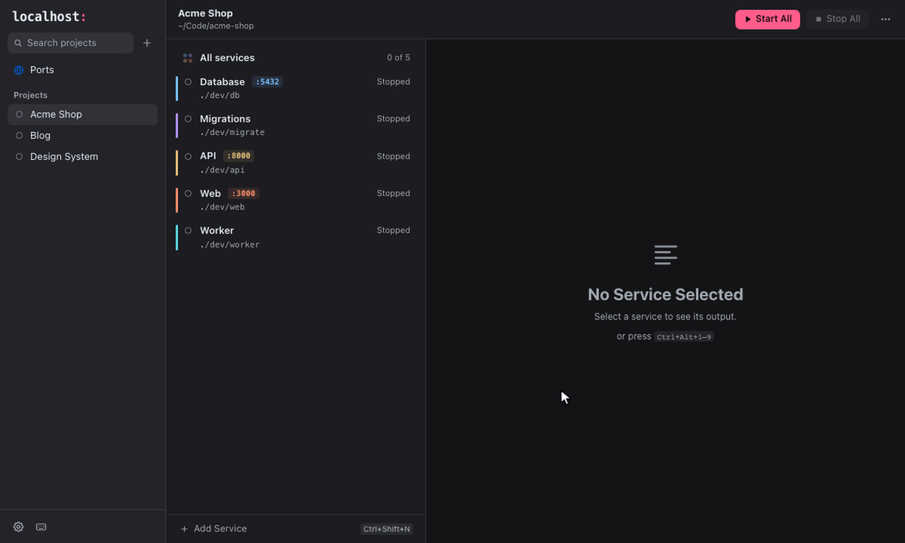
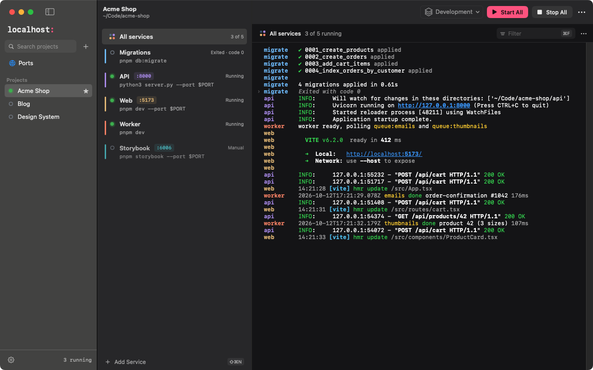
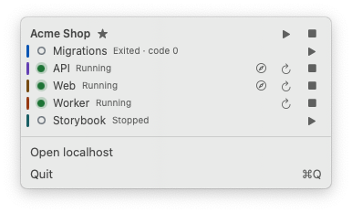
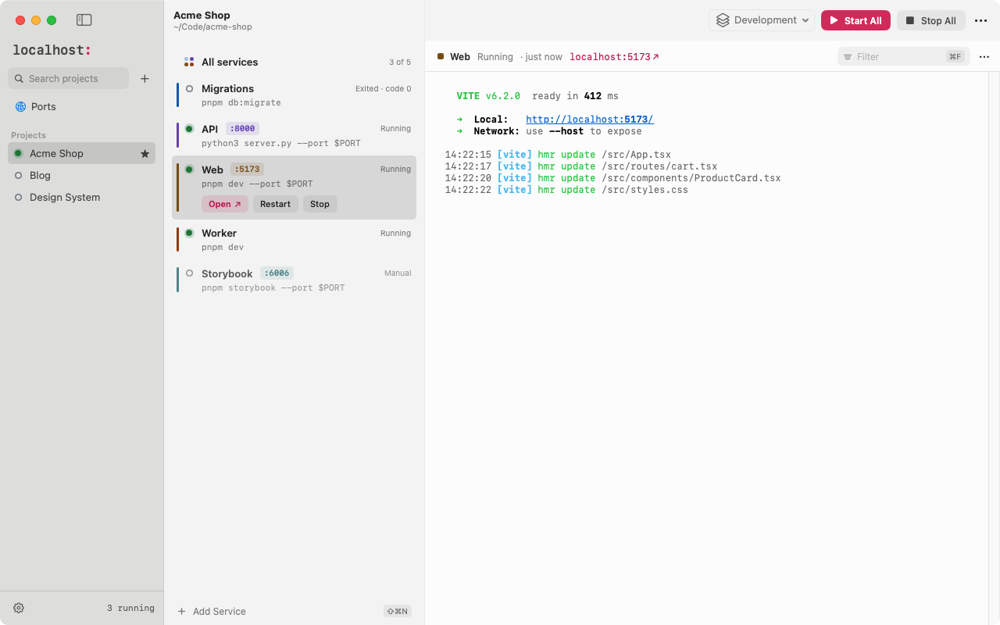
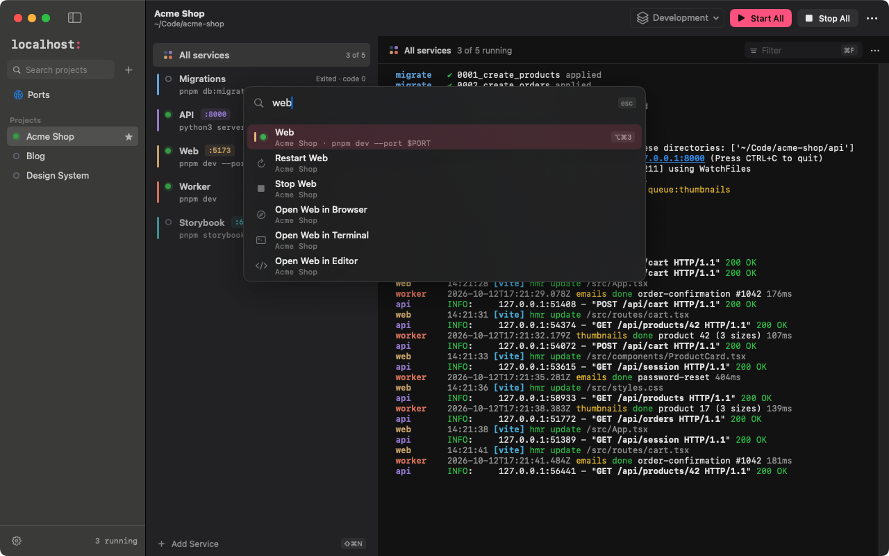

<h1 align="center">
  <picture>
    <source media="(prefers-color-scheme: dark)" srcset=".github/assets/wordmark-dark.png">
    
  </picture>
</h1>

<p align="center">Every local project, one place to run it. For macOS, Linux and Windows.</p>

localhost app (getlocalhost.app) is a free, open-source desktop process manager for local development: it starts, stops and watches all your dev servers, workers and databases from one window instead of terminal tabs. Native on macOS, built with Tauri for Windows and Linux. A GUI alternative to pm2, foreman and tmux for local dev. It also has an MCP server, localhost mcp, so AI coding agents (Claude Code, Cursor, Codex) run the same Services.

<p align="center"><a href="https://www.getlocalhost.app">www.getlocalhost.app</a> · <a href="https://www.getlocalhost.app/docs">Docs</a> · <a href="https://www.getlocalhost.app/agents">Coding agents (MCP)</a> · <a href="https://www.getlocalhost.app/changelog">Changelog</a></p>

<p align="center">
  <a href="https://github.com/marcellosso/localhost/releases/latest"></a>
  <a href="https://github.com/marcellosso/localhost/actions/workflows/ci.yml"></a>
  <a href="LICENSE"></a>
</p>

<p align="center">
  
</p>

localhost remembers how each of your local development projects runs, and lets you start, stop and watch all of its Services from one place, instead of a row of terminal tabs.

A **Project** is a folder. A **Service** is one long-running command in it: `pnpm dev`, `uv run fastapi dev`, `docker compose up postgres`, `cargo run`. localhost doesn't care what the command is: it runs it in your shell, keeps its output, knows when it is up, and stops its whole process tree when you ask.

- **One place for every project**: Start All / Stop All, Dependencies between Services (the API waits for the database), one merged log of every Service.
- **Ports that make sense**: a Service counts as Running once its Port accepts connections. If the Port is taken, localhost says by whom and can start the Service on the next free one. The **Ports** view lists everything listening on your machine, whoever started it.
- **Environment without `.env` juggling**: variables on the Project, on each Service and in Environment Profiles (Development, Testing, …). Any variable can be a Secret, kept in your system's secret store.
- **Set up in seconds**: point it at a folder and it suggests Services from `package.json` scripts, Compose files, Python apps and Cargo binaries. You review every suggestion; nothing is applied silently.
- **Keyboard first**: a command palette, a shortcut for every action, arrow keys across the window. Screen readers, light and dark, reduced motion.
- **Coding agents included**: Claude Code, Cursor, Codex and other MCP clients start, stop and inspect your Services through `localhost mcp` instead of a hidden shell. The agent and the app share one background core, so what the agent starts shows in the app, with its logs. See [Coding agents (MCP)](#coding-agents-mcp).
- **Updates that ask first**: a check at launch and every 6 hours, a notice in the sidebar, and Restart to Update stops your running Services only after asking. See [Updates](#updates).
- **Local**: no account, no cloud, works offline. Configuration lives in localhost's own storage, never in your project folders.

A native SwiftUI app on macOS with a menu bar companion; one app for Linux and Windows with a tray icon. On Windows, Projects run on Windows itself or inside a WSL 2 distro. All of them, the `localhost` command and the MCP server run on one Rust core.



## Install

Download the latest release from [GitHub Releases](https://github.com/marcellosso/localhost/releases/latest).

| | Download | Needs |
|---|---|---|
| **macOS** | `localhost-<version>.dmg`: open it and drag **localhost** to **Applications** | macOS 15 or later, Apple silicon or Intel |
| **Ubuntu, Debian** | `localhost-app_<version>_amd64.deb`: `sudo apt install ./localhost-app_<version>_amd64.deb` | Ubuntu 22.04+, Debian 12+, x86_64 |
| **Fedora** | `localhost-app-<version>-1.x86_64.rpm`: `sudo dnf install ./localhost-app-<version>-1.x86_64.rpm` | x86_64 |
| **Other Linux** | `localhost-app_<version>_amd64.AppImage`: `chmod +x` it and run it | x86_64, glibc as new as Ubuntu 22.04's |
| **Windows** | `localhost_<version>_x64-setup.exe`: run it. It installs for your user only, no administrator rights | Windows 10 or 11, x64; WSL 2 for Projects in WSL |

Releases aren't notarized or code-signed by a known publisher yet, so the first launch needs one extra step on macOS and Windows; see [First launch](#first-launch). There are no Flatpak or Snap packages: their sandboxes can't run your project's commands.

### Homebrew (macOS)

```sh
brew install --cask marcellosso/tap/localhost
```

The same app, from the same release, in **Applications**. Homebrew also links its `localhost` command into its own `bin`, so terminals can run `localhost` without Add to PATH. The app keeps updating itself, so `brew upgrade` leaves it alone. `brew uninstall --cask localhost` removes it; with `--zap` it also deletes localhost's data folder (your Projects and logs; Secrets stay in the Keychain). Homebrew marks what it downloads as quarantined, as a browser does, so the first launch needs the same extra step: see [First launch](#first-launch).

### Updates

localhost checks GitHub Releases for a new version at launch and every 6 hours. When there is one, a notice at the bottom of the sidebar says “localhost X.Y.Z is available”, with its release notes:

- **Update Now** downloads it in the background, and **Restart to Update** installs it and opens the new version. **Later** hides the notice until the next version. On macOS, an update that has downloaded also installs when you quit localhost.
- **Restarting stops every running Service first**, as quitting does, after listing them and asking. Start them again once the new version opens.
- Each update is signed, and localhost checks the signature before installing it.
- **`.deb` and `.rpm`**: your package manager installs updates, so the notice's **Download** opens the release instead. The AppImage and the Windows installer update themselves; on macOS, so does the app, also when installed with Homebrew.

Turn automatic checks off in **Settings → General**; **Check for Updates…** (in the localhost menu on macOS, in Settings or the command palette) checks at any time. Checking is the only thing localhost asks the network for, and builds you make yourself never check. More in the [Updates docs](https://www.getlocalhost.app/docs/updates).

## Getting started

Shortcuts are written for macOS; on Linux and Windows use Ctrl for ⌘ and Alt for ⌥ (see [Keyboard shortcuts](#keyboard-shortcuts)).

### 1. Add a Project

Press **⌘N** (or the **+** in the sidebar) and choose your project's folder. localhost fills in a name and a **Key** (a short handle such as `my-saas`, used in logs and by the command line), then scans the folder and lists what it found:

- **Node**: `package.json` scripts, run with your package manager (`pnpm run dev`, …). Known dev servers get their default port, passed as `$PORT`.
- **Docker Compose**: one Service per Compose service, `docker compose up <service>` in the foreground.
- **Python**: Django, FastAPI and Flask apps, with uv, Poetry, Pipenv or a virtualenv.
- **Cargo**: `cargo run` for each binary.

The likely Services are checked; the rest are folded under “N more found”. Click a row to edit it before adding, then click **Add Project**.

Nothing found, or a command it doesn't know? Add the Project anyway and add Services yourself with **⇧⌘N**. **Detect Services…** scans again later.

On Windows, Add Project also asks where the Project runs: on Windows itself, or in one of your WSL distros. See [Windows and WSL](#windows-and-wsl).

### 2. Describe a Service

A Service has:

- a **command**: one command line, run in your login shell (`$SHELL -l -c "…"`), so your `PATH`, version managers and profile apply. Pipes, `&&` and `$VARIABLES` work as in a terminal. On Windows itself it runs in `cmd.exe`;
- a **working directory** inside the Project (the Project folder by default);
- an optional **Port**. The command gets the actual port as `$PORT` (`%PORT%` in cmd), e.g. `next dev -p $PORT`, and the Service counts as Running once that port accepts connections. Without a Port it counts as Running after about 1.5 seconds;
- an optional **URL** for Open in Browser (⇧⌘O). Its port follows the actual port;
- **Starts after**: its Dependencies. Starting the Service starts them first and waits until they are Running, or have Exited for one-off steps such as migrations;
- **Manual**: Start All skips it, unless something being started depends on it.

### 3. Run it

Select a Service and press **⌘R** to start (or restart) it, **⌘.** to stop it. **⇧⌘R** starts every Service of the Project in dependency order, **⇧⌘.** stops them all.

A Service is always in one of six states:

| State | Meaning |
|---|---|
| Stopped | Not running: never started, or you stopped it. |
| Starting | Waiting for its Dependencies, or launched and not up yet. |
| Running | Up: its Port accepts connections (or it has been alive ~1.5 s). |
| Stopping | Asked to stop; waiting for every process it started to end. |
| Exited | Ended on its own with exit code 0. |
| Failed | Ended on its own with an error, or couldn't start. The reason and the last lines of output are shown. |

Stopping sends Ctrl-C (SIGINT) to the Service's whole process group, then SIGTERM after 5 seconds, then SIGKILL, so nothing is left running in the background. On Windows itself it sends Ctrl-Break, then ends every process the Service started.

Closing the window doesn't stop anything: your Services keep running, and the menu bar icon (the tray icon on Linux and Windows) shows them, with a red dot while one has Failed. Quitting asks first, then stops everything.

<p align="center"></p>

Coding agents drive the same Services through [`localhost mcp`](#coding-agents-mcp): what an agent starts shows in the app, and the reverse. If localhost's background core ever crashes, the next launch finds the Services still running from it and asks whether to stop them.

### 4. Read the logs

Select a Service to see its output, with colours. **All services** shows every Service of the Project in one stream, each line prefixed with its Key. **⌘F** filters, **⌃L** (Ctrl+L) clears the view; log files are kept. URLs in the output are clickable.



The last 5 Runs of each Service are kept on disk, up to 10 MB each (see [Data](#data)).

### 5. Environment variables and Secrets

**Edit Environment…** (in the Project's menu) holds the Project's variables and its **Environment Profiles**; each Service's own variables are in its editor. A Service gets, later ones winning:

1. your login shell's environment (on Windows, your user environment as a new sign-in would see it),
2. the Project's variables,
3. the Service's variables,
4. the active Environment Profile's variables (picked in the Project's toolbar),

plus `PORT` when it has a Port, and `FORCE_COLOR=1`, `CLICOLOR_FORCE=1`, `PYTHONUNBUFFERED=1` so tools keep their colours and don't buffer output.

Click the lock next to a variable to make it a **Secret**: its value goes to your system's secret store and stays hidden until you click the eye. Changes apply the next time a Service starts; a running Service shows “Restart to apply”.

### 6. When a port is taken

Before starting a Service with a Port, localhost checks who holds it. If something else does, the Service can start on the next free port (it gets that port as `$PORT` for this Run; the configured Port doesn't change), or you choose: stop the other process and start, start on another port, or cancel. Settings turns the automatic move off; a Service's **Port can change** switch turns it off for that Service.

The **Ports** view (**⌘0**) lists every process listening on a TCP port and whom it belongs to: one of your Services, a process running inside one of your Projects' folders, or nothing localhost knows (other apps and system services are folded below). Select one and press ⌘. to stop it; localhost asks first for anything it didn't start.

### 7. Move a Project to another machine

**Export Project…** saves a Project as a YAML Project file, and **Import Project…** reads one back, showing what it contains before adding anything; choose the folder if it is somewhere else on this machine. Secret values are never exported: the file lists Secret names, and the import shows which ones to fill in. The format is in [docs/configuration.md](docs/configuration.md).

## Keyboard shortcuts



| | macOS | Linux, Windows |
|---|---|---|
| Command palette: jump to anything, run any action | ⌘K | Ctrl+K |
| New Project / New Service | ⌘N / ⇧⌘N | Ctrl+N / Ctrl+Shift+N |
| Start or restart / stop the selected Service | ⌘R / ⌘. | Ctrl+R / Ctrl+. |
| Start All / Stop All in the Project | ⇧⌘R / ⇧⌘. | Ctrl+Shift+R / Ctrl+Shift+. |
| Open the Service's URL | ⇧⌘O | Ctrl+Shift+O |
| Filter / clear the log | ⌘F / ⌃L | Ctrl+F / Ctrl+L |
| Open the folder in Terminal / your editor / Finder | ⌥⌘T / ⌥⌘E / ⌥⌘F | from the folder's menu |
| Projects 1–9, Ports | ⌘1–9, ⌘0 | Ctrl+1–9, Ctrl+0 |
| Services 1–9; previous / next Service | ⌥⌘1–9, ⌘[ / ⌘] | Ctrl+Alt+1–9, Ctrl+[ / Ctrl+] |
| Move between the sidebar, the Services and the log | ← → ↑ ↓ | ← → ↑ ↓ |
| Settings / all shortcuts | ⌘, / ⌘/ | Ctrl+, / Ctrl+/ |

Hold ⌘ (Ctrl) for a moment to see the Projects' numbers, or ⌥⌘ (Ctrl+Alt) for the Services'. On macOS every action is also in the menus, so menu search (⇧⌘/) finds it.

## First launch

### macOS: a build that isn't notarized

Releases aren't notarized by Apple yet, so macOS refuses to open what your browser downloaded the first time (“Apple could not verify “localhost” is free of malware…”; it may name the DMG instead). There are three ways past it, each only for a copy from this project's releases, and each new version needs one again.

**Open Anyway**, in System Settings:

1. Click **Done** in that dialog.
2. Open **System Settings → Privacy & Security** and scroll to **Security**. It says the item was blocked to protect your Mac.
3. Click **Open Anyway**, confirm with your password or Touch ID, then click **Open Anyway** once more.

<p align="center"></p>
<p align="center"><em>System Settings → Privacy &amp; Security → Open Anyway.</em></p>

If the warning named the DMG, macOS may ask again the first time you open localhost: do the same.

**Download from Terminal.** macOS only checks files marked as downloaded from the internet, and `curl` doesn't mark them. Download and open the DMG, then drag **localhost** to **Applications** as usual:

```sh
curl -fLO https://github.com/marcellosso/localhost/releases/download/v<version>/localhost-<version>.dmg
open localhost-<version>.dmg
```

To check the download, also fetch `localhost-<version>.dmg.sha256` from the same release and run `shasum -a 256 -c localhost-<version>.dmg.sha256`.

**Remove the quarantine flag** the browser added, from Terminal, once localhost is in Applications:

```sh
xattr -dr com.apple.quarantine /Applications/localhost.app
```

### Windows: SmartScreen

Unsigned releases make SmartScreen say “Windows protected your PC”. Click **More info**, check that the file name is what you downloaded from this project's releases, then click **Run anyway**. Each new version asks once again.

<p align="center"></p>
<p align="center"><em>Click More info…</em></p>
<p align="center"></p>
<p align="center"><em>…check the file name, then click Run anyway.</em></p>

## Platform notes

### macOS: Keychain prompts for Secrets

Secret values live in your login Keychain. macOS lets the app that saved them read them without asking, and recognises “the same app” by its code signature:

- **Release builds** are signed with the same certificate every time, so updating keeps access: no prompts.
- **Builds signed ad hoc** (including ones you build yourself) look like a new app after every update. The first time each Secret is used, macOS asks “localhost wants to use your confidential information stored in “io.github.marcellosso.localhost.secret” in your keychain”. Enter your login password and click **Always Allow**.
- **When the signing identity changes** (for example once releases are notarized), macOS asks once for each Secret on that one update.
- **`localhost mcp`** is another program than the app, so macOS asks it separately the first time it reads each Secret. It reads only the Secrets of the Services an agent starts, and of their Dependencies, as it starts them.

**Deny** isn't remembered: Services that use that Secret fail to start, and the next start asks again.

### Linux: a Secret Service

Secret values are kept by your desktop's **Secret Service**: GNOME Keyring on GNOME, KWallet on KDE Plasma, or another provider such as KeePassXC with Secret Service enabled. Most desktops run one already. Without one, Services that use a Secret fail to start with “The secret store refused: …”, and saving a Secret fails the same way; everything else works.

### Linux: the tray icon on GNOME

The tray icon uses AppIndicator. KDE Plasma, Cinnamon, Xfce and Ubuntu's GNOME show it as is. Stock GNOME, as on Fedora, needs the [AppIndicator and KStatusNotifierItem Support](https://extensions.gnome.org/extension/615/appindicator-support/) extension (`gnome-shell-extension-appindicator` on Fedora).

Without a tray nothing is lost: closing the window still leaves your Services running, and launching localhost again brings the window back. Quit with Ctrl+Q.

### Windows and WSL

A Project runs on its **Execution Target**: Windows itself (the default), or a WSL distro such as Ubuntu.

- **On Windows itself**, commands run in `cmd.exe` with your user environment read fresh at every start, so a toolchain you just installed is found without restarting localhost. Version managers that only work through a PowerShell profile (fnm or mise in `activate` mode) aren't seen; their shim modes, nvm-windows and Volta are.
- **In WSL**, pick the folder under **Linux** in the folder picker (`\\wsl.localhost\<distro>\…`). Commands, detection and the Ports view run inside the distro, as on Linux. A folder on a Windows drive also works, through `/mnt/c/…`, but is much slower. The first time a distro is used, localhost copies a small helper, `localhostd`, into `~/.local/share/localhost/windows/` there; it is replaced when localhost updates, and stops every Service it started when localhost quits.
- Open in Browser uses `localhost:<port>`, which WSL forwards to Windows by default. If a Service in WSL is Running but the browser can't reach it, check that `%UserProfile%\.wslconfig` doesn't turn `localhostForwarding` off, then run `wsl --shutdown` and start it again.
- Open in Terminal uses Windows Terminal (with the distro's profile for WSL Projects). VS Code, Cursor, VSCodium and Windsurf open WSL folders through their WSL remote.
- Windows puts a new app's tray icon in the overflow (the `^` next to the clock). To keep it on the taskbar, turn localhost on in **Settings › Personalization › Taskbar › Other system tray icons**. Left-click it to open the window, right-click it for the menu.

Uninstall from **Settings › Apps › Installed apps**, then remove the copies in each distro with `rm -rf ~/.local/share/localhost/windows`.

## Data

| | Configuration, logs and Run records | Secret values |
|---|---|---|
| macOS | `~/Library/Application Support/localhost` | login Keychain, service `io.github.marcellosso.localhost.secret` |
| Linux | `~/.local/share/localhost` (or `$XDG_DATA_HOME/localhost`) | Secret Service, attributes `service` = `io.github.marcellosso.localhost.secret` and `account` |
| Windows | `%APPDATA%\localhost`; a WSL Project's logs and Run records stay in its distro, under `~/.local/share/localhost/windows/` | Credential Manager, generic credentials `io.github.marcellosso.localhost.secret/<account>` |

Inside that folder:

- `projects/`: one JSON file per Project. A file that can't be read is renamed to `….unreadable` and reported at launch, never deleted.
- `logs/`: each Run's output, the last 5 Runs per Service.
- `runs/`: the Runs active right now, to find leftovers after a crash.
- `agent-backups/`: each coding agent's configuration file as it was before localhost first connected it.
- `bin/`: the AppImage's `localhost` command, copied out for coding agents (Linux AppImage only).

The Linux and Windows app keeps its settings in `~/.config/io.github.marcellosso.localhost.desktop` or `%APPDATA%\io.github.marcellosso.localhost.desktop`. Set `LOCALHOST_STORAGE_ROOT` to use another folder, e.g. to try a build without touching your data.

## The command line

The `localhost` command runs on the same core and the same data as the app: list Projects, see what is running, read the latest logs, or run a Project's Services in the foreground until Ctrl-C. It comes with the app, the same version: **Settings › Agents › Use localhost in a terminal › Add to PATH** links it into `~/.local/bin` on macOS and Linux and adds the app's folder to your user `PATH` on Windows, and **Remove from PATH** undoes it. The Linux `.deb` and `.rpm` install it as `/usr/bin/localhost`, and the [Homebrew](#homebrew-macos) cask links it into Homebrew's `bin`. To build it yourself, see [core/README.md](core/README.md#the-localhost-command).

```sh
localhost projects
localhost status my-saas
localhost logs my-saas web
localhost up my-saas
localhost mcp
```

## Coding agents (MCP)

`localhost mcp` is a [Model Context Protocol](https://modelcontextprotocol.io) server on stdin and stdout. Coding agents use it to start, stop and inspect your Services instead of starting dev servers in a shell you can't see: `list_projects`, `list_services`, `status`, `start_service`, `stop_service`, `start_project`, `stop_project`, `logs` and `ports`. An agent and the app drive the same background core: what one starts is Running in the other, and a stop from either stops it. An agent never starts a second copy of a running Service, can't change your configuration, and reads only the Secrets of the Services it starts. The Services an agent starts stop when it disconnects, unless the app is open.

**Connect from the app.** Open **Settings › Agents** (or **Connect Agents…** in the command palette) and click **Connect** next to Claude Code, Cursor or Codex. Before you click, **What changes** shows exactly what localhost writes:

| Agent | MCP server added to | Skill installed in |
|---|---|---|
| Claude Code | `~/.claude.json` (user scope, every project) | `~/.claude/skills/localhost-mcp/` |
| Cursor | `~/.cursor/mcp.json` | `~/.cursor/skills/localhost-mcp/`, unless Claude Code's or Codex's folder has it (Cursor reads those too) |
| Codex | `~/.codex/config.toml` | `~/.agents/skills/localhost-mcp/` |

The entry is a server named `localhost` that runs the command bundled with the app (`localhost.app/Contents/Helpers/localhost` on macOS, `localhost.exe` beside the app on Windows, `/usr/bin/localhost` from the `.deb` and `.rpm`, a copy in localhost's data folder for the AppImage) with `mcp`, so the agent always runs the same version as the app. Only localhost's own entry changes: every other server and setting stays as it was. With Claude Code installed, localhost runs `claude mcp add-json` / `claude mcp remove` instead of editing `~/.claude.json` itself. The app opens this screen by itself once, at its first launch. Restart to Update asks before it disconnects connected agents, along with stopping your Services, so the update can replace the command they run. Each file is backed up to `agent-backups/` in localhost's data folder before the first change, connecting again changes nothing, and **Disconnect** removes only localhost's entry and skill. If an agent's `localhost` server runs another command, such as `~/.cargo/bin/localhost`, the app offers **Update**.

**Or from a terminal**, with the app installed:

```sh
npx @getlocalhost/cli mcp install
```

It writes the same entries as **Connect** for every agent it finds, and Claude Desktop's `claude_desktop_config.json` too (macOS, Windows); `mcp uninstall` removes them, `mcp status` shows where each agent stands, `--client cursor` picks one and `--dry-run` prints the diff instead. Without the app it changes nothing and says how to install it. See [packages/cli](packages/cli/README.md).

**Or by hand**, for other MCP clients: give the bundled command the argument `mcp`.

- **Claude Code**: `claude mcp add --scope user localhost -- /Applications/localhost.app/Contents/Helpers/localhost mcp`
- **Codex**: `codex mcp add localhost -- /Applications/localhost.app/Contents/Helpers/localhost mcp`
- **Cursor**: add this to `~/.cursor/mcp.json` (or `.cursor/mcp.json` in one project):

  ```json
  {
    "mcpServers": {
      "localhost": { "type": "stdio", "command": "/Applications/localhost.app/Contents/Helpers/localhost", "args": ["mcp"] }
    }
  }
  ```

Other MCP clients take the same `command` and `args`. On Windows it covers Projects on Windows itself; a Project in a WSL distro runs only from the app, and agents installed inside a WSL distro are set up by hand. The skill is in [skills/localhost-mcp/SKILL.md](skills/localhost-mcp/SKILL.md): copy the `localhost-mcp` folder to `~/.claude/skills/`, `~/.cursor/skills/` or `~/.agents/skills/`. More in the [MCP docs](https://www.getlocalhost.app/docs/mcp), the [skill docs](https://www.getlocalhost.app/docs/skills) and [localhost for AI coding agents](https://www.getlocalhost.app/agents).

## FAQ

### What is localhost app?

localhost app (getlocalhost.app) is a free, open-source desktop process manager for local development: it starts, stops and watches all your dev servers, workers and databases from one window instead of terminal tabs. Native on macOS, built with Tauri for Windows and Linux. A GUI alternative to pm2, foreman and tmux for local dev. It also has an MCP server, localhost mcp, so AI coding agents (Claude Code, Cursor, Codex) run the same Services.

A Project is a folder; a Service is one long-running command in it, such as `pnpm dev`, `uv run fastapi dev` or `docker compose up postgres`. localhost runs it in your login shell, keeps its output, knows when it is up, and stops its whole process tree when you ask.

### Is localhost a pm2 alternative?

For local development, yes. pm2 is a production process manager, mainly for Node.js/Bun apps, built to keep them alive on servers. localhost is built for the dev servers on your own machine: a window per Project, Dependencies between Services, a Ports view and one merged log. It never restarts a Service on its own. To keep processes running in production, keep pm2.

### How do I run frontend, backend and database together?

Add the Project’s folder and localhost suggests Services from `package.json` scripts, Compose files, Python apps and Cargo binaries. Make the API start after the database, then press Start All (⇧⌘R, or Ctrl+Shift+R on Linux and Windows): each Service waits until its Dependencies are Running, and All services shows every log in one stream.

### Can AI coding agents start my dev servers through localhost?

Yes. `localhost mcp` is an MCP server for Claude Code, Cursor, Codex and other coding agents: they list your Projects, start and stop Services, and read their status, logs and ports, instead of running `pnpm dev` in a shell you can’t see. The agent and the app share one background core, so what the agent starts shows in the app, and the Services it started stop when it disconnects, unless the app is open.

### Is it free and open source?

Yes. localhost is free and open source under the MIT license. There is no account and no backend, and it works offline.

### Does it work on Windows/WSL and Linux?

Yes. On Windows 10 or 11 (x64), a Project runs on Windows itself or inside a WSL 2 distro. On Linux there are `.deb` (Ubuntu 22.04+, Debian 12+), `.rpm` (Fedora) and AppImage packages for x86_64. On macOS it needs macOS 15 or later, on Apple silicon or Intel, and Homebrew installs it too: `brew install --cask marcellosso/tap/localhost`.

Releases aren’t notarized yet, so the first launch on macOS needs one extra step: System Settings → Privacy & Security → Open Anyway, or `xattr -dr com.apple.quarantine /Applications/localhost.app` in Terminal. On Windows, SmartScreen asks once: click More info, then Run anyway.

## How it compares

Plenty of good tools overlap with localhost, and several are the better choice for some jobs. The full comparison, with where each one wins, is at [getlocalhost.app/compare](https://www.getlocalhost.app/compare).

| Tool | Where it wins | Where localhost fits better |
|---|---|---|
| **pm2** | Supervising production processes on servers | Dev servers on your own machine, with a GUI |
| **foreman, overmind, honcho** | A shared `Procfile` in the repo, terminal and SSH workflows | Per-Service control, Port readiness and logs in a window |
| **tmux, tmuxinator** | Remote and headless work, interactive programs | State, Ports and process trees managed for you |
| **Docker Compose** | Containerized, reproducible stacks | Native commands next to your Compose services |
| **concurrently** | A one-line `npm run dev` for the whole team, in CI too | Per-Service control, Dependencies and kept logs |
| **devglow, DevWebUI** | Agents can register and edit projects | MIT license; Linux packages; agents connected in one click and can’t add, edit or delete Projects |

localhost isn’t a production or remote-server dashboard, a container or Kubernetes tool, a terminal emulator or a cloud service. It runs commands on your own machine, the way you would in a terminal, and remembers how each Project runs.

## Contributing

Bug reports, ideas and pull requests are welcome. See [CONTRIBUTING.md](CONTRIBUTING.md) to build and test it, and [AGENTS.md](AGENTS.md) for how it works and the rules it keeps. Everyone taking part follows the [Code of Conduct](CODE_OF_CONDUCT.md). To report a security issue, see [SECURITY.md](SECURITY.md).

## License

MIT, see [LICENSE](LICENSE).
