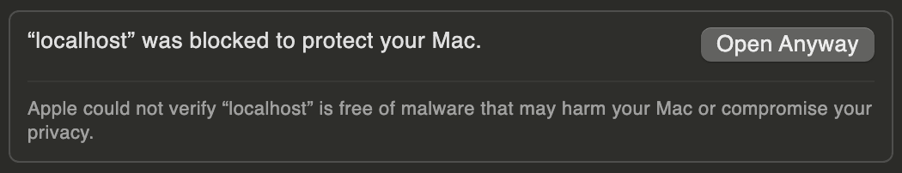
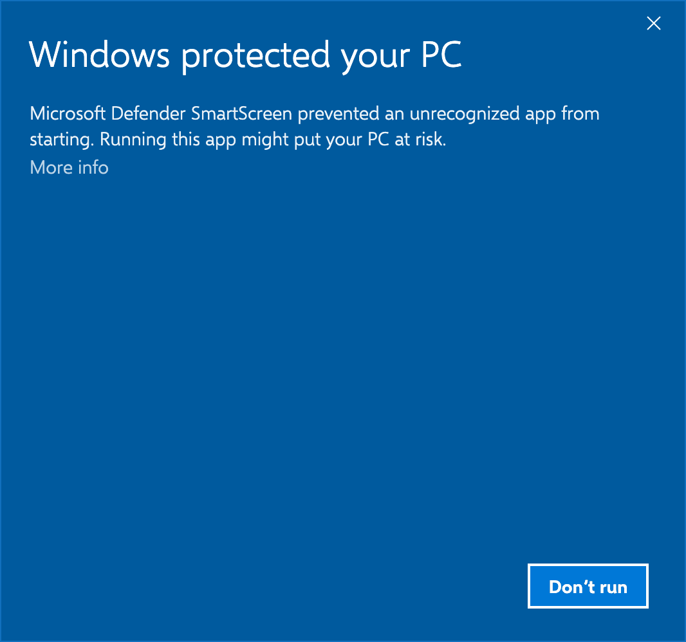
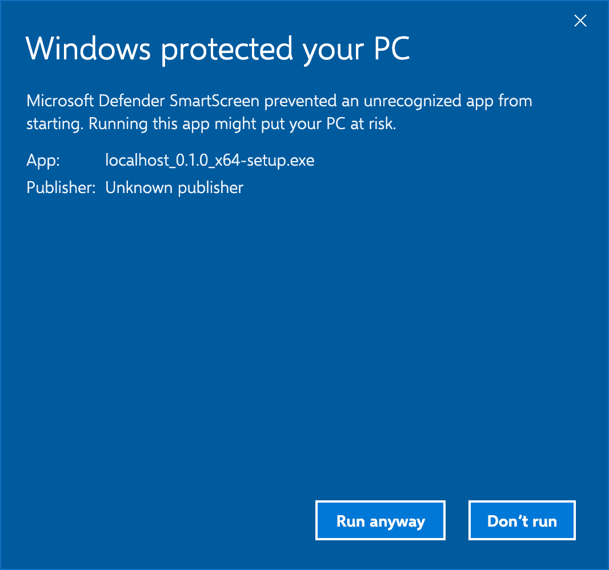

Download the latest release from [GitHub Releases](https://github.com/marcellosso/localhost/releases/latest).

| | Download | Needs |
|---|---|---|
| **macOS** | `localhost-<version>.dmg`: open it and drag **localhost** to **Applications** | macOS 15 or later, Apple silicon or Intel |
| **Ubuntu, Debian** | `localhost-app_<version>_amd64.deb`: `sudo apt install ./localhost-app_<version>_amd64.deb` | Ubuntu 22.04+, Debian 12+, x86_64 |
| **Fedora** | `localhost-app-<version>-1.x86_64.rpm`: `sudo dnf install ./localhost-app-<version>-1.x86_64.rpm` | x86_64 |
| **Other Linux** | `localhost-app_<version>_amd64.AppImage`: `chmod +x` it and run it | x86_64, glibc as new as Ubuntu 22.04's |
| **Windows** | `localhost_<version>_x64-setup.exe`: run it. It installs for your user only, no administrator rights | Windows 10 or 11, x64; WSL 2 for Projects in WSL |

Releases aren't notarized or code-signed by a known publisher yet, so the first launch needs one extra step on macOS and Windows; see [First launch](#first-launch). There are no Flatpak or Snap packages: their sandboxes can't run your project's commands.

## First launch

### macOS: a build that isn't notarized

Releases aren't notarized by Apple yet, so macOS refuses to open what your browser downloaded the first time (“Apple could not verify “localhost” is free of malware…”; it may name the DMG instead). There are three ways past it, each only for a copy from this project's releases, and each new version needs one again.

**Open Anyway**, in System Settings:

1. Click **Done** in that dialog.
2. Open **System Settings → Privacy & Security** and scroll to **Security**. It says the item was blocked to protect your Mac.
3. Click **Open Anyway**, confirm with your password or Touch ID, then click **Open Anyway** once more.


*System Settings → Privacy & Security → Open Anyway.*

If the warning named the DMG, macOS may ask again the first time you open localhost: do the same.

**Download from Terminal.** macOS only checks files marked as downloaded from the internet, and `curl` doesn't mark them. Download and open the DMG, then drag **localhost** to **Applications** as usual:

```sh
curl -fLO https://github.com/marcellosso/localhost/releases/download/v<version>/localhost-<version>.dmg
open localhost-<version>.dmg
```

To check the download, also fetch `localhost-<version>.dmg.sha256` from the same release and run `shasum -a 256 -c localhost-<version>.dmg.sha256`.

**Remove the quarantine flag** the browser added, from Terminal, once localhost is in Applications:

```sh
xattr -dr com.apple.quarantine /Applications/localhost.app
```

### Windows: SmartScreen

Unsigned releases make SmartScreen say “Windows protected your PC”. Click **More info**, check that the file name is what you downloaded from this project's releases, then click **Run anyway**. Each new version asks once again.


*Click More info…*


*…check the file name, then click Run anyway.*

Next: [add your first Project](/docs/quick-start).
